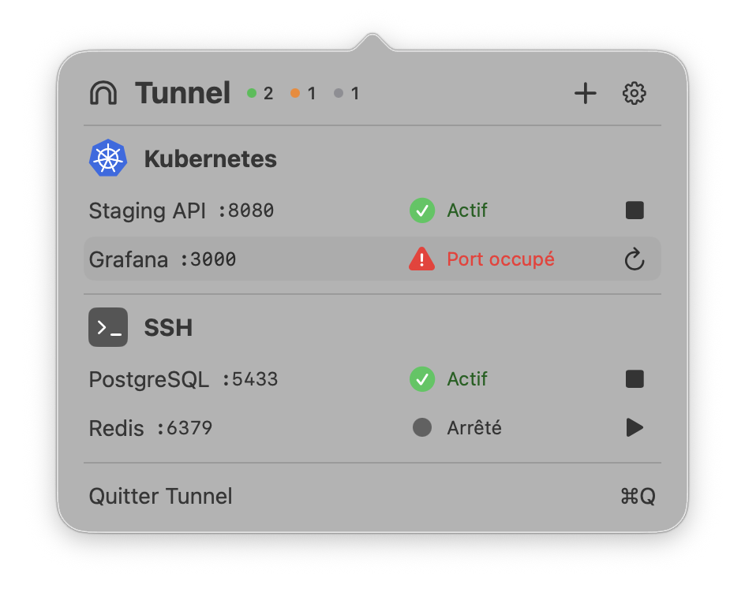
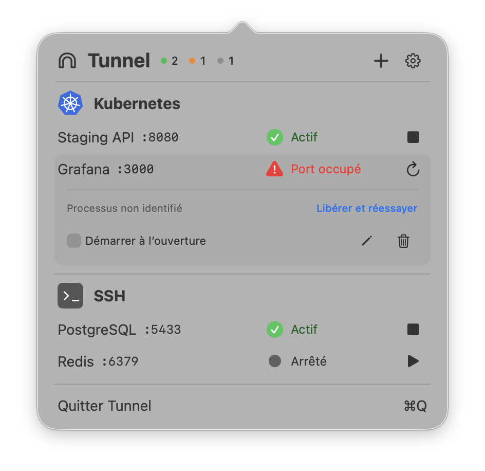

# Tunnel

Tunnel is a native macOS menu bar app for managing SSH local forwards and
`kubectl port-forward` sessions across Kubernetes contexts. It replaces repeated
manual commands with a searchable interface, saved tunnels, and one-click controls.



The screenshots use fictional tunnels and simulated connection states.

Use it when local development depends on several cluster services: APIs,
workers, dashboards, internal tools, or anything else that normally requires a
terminal full of long-running `kubectl port-forward` commands.

## Why It Is Useful

- Start common forwards from the menu bar without remembering namespaces,
  contexts, service names, or port pairs.
- Keep a saved list of forwards per machine and restart them when needed.
- Check the menu bar badge for the overall state: red for an error, orange for
  a connection or reconnection in progress, and green when a tunnel is active.
  Open the popover for counts and individual status, grouped by protocol.
- Search services across Kubernetes contexts instead of hand-building commands.
- Detect local port conflicts before starting a session.
- Auto-restart interrupted forwards with backoff.

## What Tunnel Does

- Targets `services/<name>` so Kubernetes selects a healthy pod behind the
  service.
- Tracks each forward through idle, connecting, running, reconnecting, and failed
  states.
- Spawns `kubectl` with a predictable `PATH` so Homebrew tools and OIDC plugins
  can be found.
- Reads Kubernetes configuration through `kubectl`; it does not modify
  `~/.kube/config`.
- Persists saved forwards as JSON in Application Support.

## Requirements

- macOS 14 or later
- Xcode 16 or later
- [XcodeGen](https://github.com/yonaskolb/XcodeGen)
- For Kubernetes, `kubectl` on `PATH`, commonly `/opt/homebrew/bin/kubectl` or
  `/usr/local/bin/kubectl`
- For OIDC clusters, `kubelogin` / `oidc-login` available on the app's execution
  path

## Build And Run

Generate the Xcode project:

```bash
brew install xcodegen
xcodegen generate
```

Open the project:

```bash
open Tunnel.xcodeproj
```

In Xcode, select the `Tunnel` scheme, choose `My Mac`, and run. Tunnel is an
`LSUIElement` menu bar app, so it appears in the macOS menu bar instead of the
Dock.

Build from the command line:

```bash
xcodebuild -project Tunnel.xcodeproj -scheme Tunnel -configuration Debug build
```

Run tests:

```bash
xcodebuild -project Tunnel.xcodeproj -scheme Tunnel -destination 'platform=macOS' test
```

## Workflow

1. Open Tunnel from the menu bar.
2. Click **+** (**Add tunnel**) and choose **SSH** or **Kubernetes**. For Kubernetes,
   select a service from the catalog or enter its details manually.
3. Start or stop forwards from the popover.
4. Enable auto-start for forwards that should come back when the app launches.
5. After editing `forwards.json` by hand, right-click the popover heading and
   choose **Recharger les tunnels**. Open **Réglages** with the gear next to **+**.

### Local port conflicts

Click a tunnel marked **Port occupé** to see which process owns the port, if
Tunnel can identify it. **Libérer et réessayer** stops that process before
retrying, so use it only if you recognize the process and no longer need it.



### SSH example: a service on your VPS

To replace `ssh -N -o ExitOnForwardFailure=yes -o ServerAliveInterval=30 -o BatchMode=yes -L 127.0.0.1:8787:127.0.0.1:8787 vps`, choose **Add tunnel → SSH** and enter:

| Field | Value |
| --- | --- |
| SSH host | `vps` |
| Local port | `8787` |
| Destination host | `127.0.0.1` (as seen from the VPS) |
| Destination port | `8787` |

The local listener is `127.0.0.1:8787` on your Mac. `vps` must be a hostname or
an OpenSSH `Host` alias in `~/.ssh/config`, not a shell alias. Tunnel uses the
system OpenSSH client in batch mode: make sure the host key is trusted and your
SSH key or agent works without a prompt. If you already started the command in
Terminal, stop it there before starting the tunnel in the app.

## How It Works

```text
MenuBarView
    |
    v
AppState
    |
    +--> ConfigStore
    +--> ServiceCatalog
    +--> PortForwardManager
              |
              v
          PortForwardSession → kubectl or OpenSSH
```

`PortForwardSession` watches `kubectl` output for readiness. For SSH, it checks
that the OpenSSH process owns the local listener. This does not test the remote
service itself. `PortForwardManager` owns process lifecycle and reconnect behavior.

## Project Structure

- `Tunnel/App/` app entry point and status item setup
- `Tunnel/Models/` Kubernetes and port-forward data types
- `Tunnel/Services/` kubectl integration, service catalog, and session
  management
- `Tunnel/State/` app state and persistent config store
- `Tunnel/Views/` SwiftUI menu bar UI
- `TunnelTests/` unit tests
- `Docs/` README screenshots
- `SPEC.md` design notes
- `project.yml` XcodeGen project definition

## Local Data

Saved forwards live at:

```text
~/Library/Application Support/Tunnel/forwards.json
```

The file is JSON, version-stamped, and written atomically.

It is read once at launch; there is no file watcher. After editing it by hand,
right-click the popover heading and choose **Recharger les tunnels**:

- forwards removed from the file are stopped;
- new forwards appear idle (`autoStart` only applies at launch);
- edited forwards that were running are restarted with the new settings.

The file is validated on load (unique ids, required fields, local port
1024–65535, remote port 1–65535). If it is invalid, the current list is kept and
the error is shown in the menu.

Tunnel rewrites the whole file on every change made in the UI, so reload before
making UI changes or your hand edits will be overwritten.

## Known Limitations

- Kubernetes forwards target services, not raw pods or selectors.
- SSH supports local forwards to a hostname or IPv4 destination, not reverse or SOCKS tunnels.
- Local ports must be 1024 or higher.
- Configuration is per machine; there is no iCloud sync.
- The app is intended to be run from Xcode or a locally built app bundle during
  development.

## Regenerating The Project

`project.yml` is the source of truth for the Xcode project. If target structure
or build settings change, regenerate:

```bash
xcodegen generate
```

Have fun
